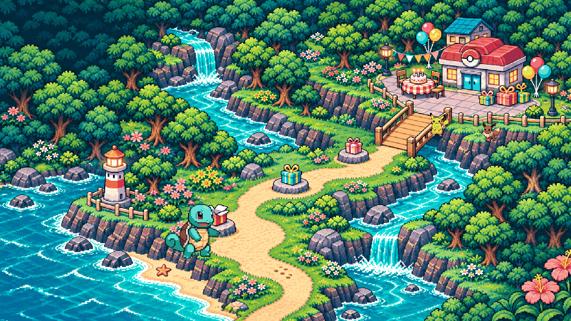
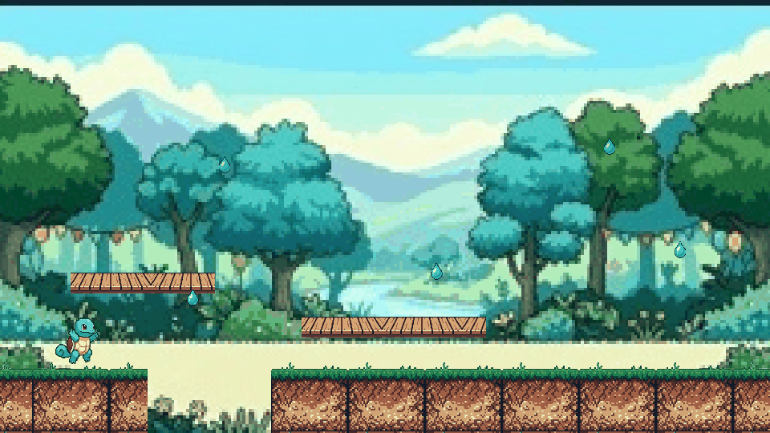
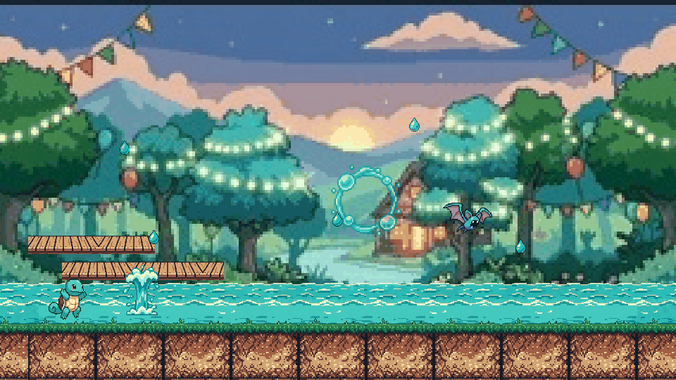
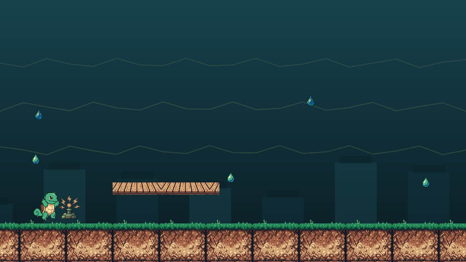
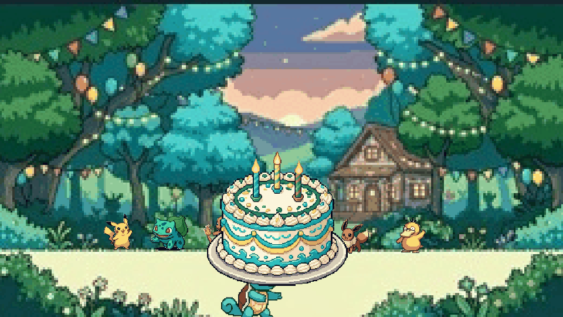
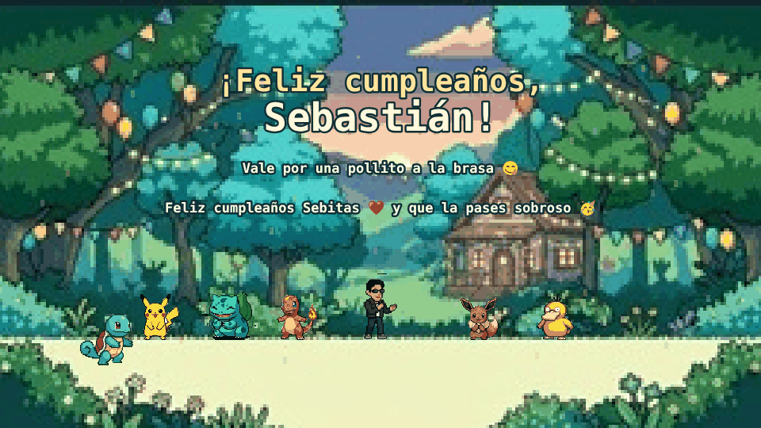

# 🎮 Operación Cumpleaños de Sebas

<p align="center">
  
</p>

<p align="center">
  <a href="https://feliz-cumple-sebas.sofiadextre09.workers.dev/">
    
  </a>
</p>

<p align="center">
  
  
  
  
  
</p>

Un plataformero de cumpleaños hecho a medida: un recorrido continuo de 40 pantallas ambientado con personajes de Pokémon, diseñado y programado desde cero como regalo personalizado. Sin backend, sin build, sin dependencias — solo HTML5 Canvas y JavaScript puro corriendo directo en el navegador.

## ✨ Qué tiene el juego

- **7 etapas con identidad propia**: pradera de salida, bosque de los saltos, río de las corrientes, cielo de burbujas, ruinas eléctricas, gran puente de la fiesta y últimas luces.
- **150 gotitas coleccionables** y **3 regalos escondidos** repartidos a lo largo del recorrido.
- **Mecánicas variadas**: salto con coyote-time y buffer, natación, chorro de agua, escudo burbuja, vuelo temporal.
- **Compañeros Pokémon** que se suman a la fiesta final: Pikachu, Bulbasaur, Charmander, Eevee, Psyduck.
- **Fondos dinámicos** por tramo (día, cuatro variantes de bosque/río, cuatro de fiesta, noche) y un fondo técnico dibujado directamente en Canvas para el tramo de ruinas, que no tenía arte propio, en vez de improvisar una imagen que no encajara con el resto.
- **Audio sintetizado**: los efectos de salto, golpe, recolección y escudo se generan en tiempo real con Web Audio API, sin archivos de sonido extra.
- **Controles táctiles** para celular en horizontal, con soporte multitáctil.
- **Mensaje final y regalo personalizados** al completar el recorrido.

## 📸 Capturas

<table>
<tr>
<td width="50%"></td>
<td width="50%"></td>
</tr>
<tr>
<td align="center"><sub>Bosque de los saltos</sub></td>
<td align="center"><sub>El gran puente, de noche, con escudo y Zubat</sub></td>
</tr>
<tr>
<td width="50%"></td>
<td width="50%"></td>
</tr>
<tr>
<td align="center"><sub>Ruinas eléctricas — fondo dibujado en Canvas</sub></td>
<td align="center"><sub>La fiesta, con todos los compañeros reunidos</sub></td>
</tr>
</table>

<p align="center">
  
</p>

## 🛠️ Stack técnico

- **JavaScript (ES Modules)** — sin framework, sin bundler, sin paso de build.
- **HTML5 Canvas 2D** para todo el renderizado del mundo, los personajes y los efectos.
- **Web Audio API** para los efectos de sonido, sintetizados en tiempo real.
- **CSS puro** para la interfaz (HUD, overlays, controles táctiles) con diseño responsive.
- **`node --test`** para las pruebas unitarias (fondos por tramo, reparto de gotitas, recuperación, pausa).
- **Playwright** para un bot que juega el recorrido completo de punta a punta y confirma que llega a la fiesta.

## 🗂️ Estructura

```
juego-replit/
├── index.html          punto de entrada
├── styles.css           interfaz y HUD
├── src/
│   ├── main.js           wiring del DOM, input y loop de render
│   ├── game.js           simulación, física y estado del juego
│   ├── level.js          geometría del nivel y coleccionables
│   ├── art.js            carga de sprites y recortes del atlas
│   ├── audio.js          música y SFX sintetizados
│   ├── scene.js           funciones puras de renderizado
│   └── config.js          título, física, mensaje final, rutas de audio
└── assets/               arte, fondos, audio y fuente
```

## ▶️ Cómo correrlo

No necesita instalación ni build. Cualquier servidor estático sirve:

```sh
python3 -m http.server 5000
```

Y abres `http://localhost:5000`.

## 🎮 Controles

| Acción | Teclado | Táctil |
|---|---|---|
| Moverse | ←/→ o A/D | Botones IZQ / DER |
| Saltar o subir | Espacio (mantener alarga el salto) | Saltar |
| Chorro de agua | J | Agua |
| Escudo burbuja (desde etapa 2) | K | Escudo |
| Pausa | Esc o P | — |

## 🧪 Verificación

```sh
npm test               # fondos por tramo, reparto y unicidad de gotitas, regalos, pausa
npm run test:journey   # bot que completa las 40 pantallas y los 3 regalos
```

## 👤 Autora

Hecho por **Sofia Dextre** como regalo de cumpleaños y ejercicio de diseño de juegos 2D desde cero — física de plataformas, sprite-sheets, fondos procedurales y audio sintetizado, sin motor externo.
